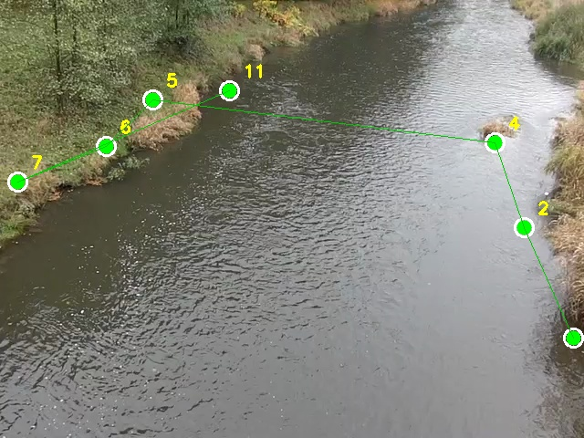
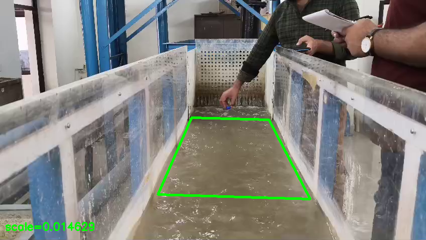
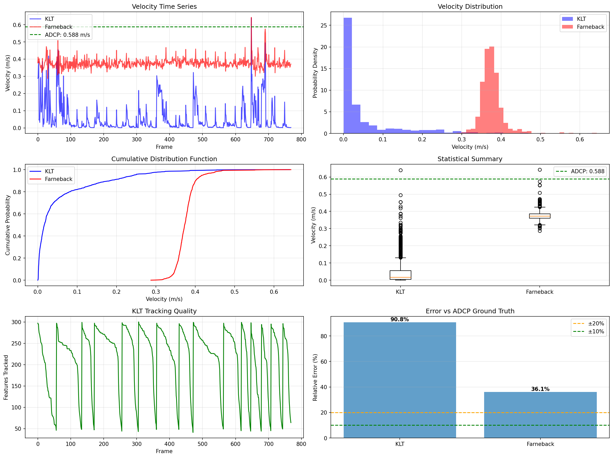

# River Surface Velocity from Camera Video

Image-based river-surface velocimetry: estimate surface flow velocity (m/s) from a fixed camera using
optical flow, calibrated to metric units, and validated against ADCP (acoustic Doppler) measurements.
Work done as a Research Assistant at the **Water Resources Development & Management Dept., IIT Roorkee**
(Prof. K. S. Kasiviswanathan), 2025–26, including field deployments on the Ganga.

<p align="center"> </p>

## Method
1. **Region of interest** – a 4-point polygon over flowing water, selected by clicking (`select_roi.py`) or detected
   automatically from flow magnitude (`calibrate_roi.py`).
2. **Scale calibration** – metres-per-pixel from a two-point reference of known length, ground-control points, or camera
   height/angle geometry; optional perspective rectification by homography (`perspective_estimator.py`).
3. **Pre-processing** – CLAHE contrast enhancement and high-pass filtering for low-light / low-texture water.
4. **Velocity estimation** – two estimators run side by side:
   * sparse **Shi-Tomasi + KLT (Lucas–Kanade)** tracking with forward–backward error rejection;
   * dense **Farneback** optical flow over the ROI.
   An adaptive ensemble weights them by track quality; Savitzky–Golay / median filtering smooths the series.
5. **Validation** – frame-wise velocities are compared with the ADCP cross-section mean (`validate_adcp.py`).

## Results (OPARA benchmark, Freiberger Mulde, ADCP mean 0.588 m/s)
| Method | Mean velocity (m/s) | Std (m/s) | Error vs ADCP |
|---|---|---|---|
| Sparse KLT tracking | 0.374 | 0.163 | 36.4 % |
| Dense Farneback flow | 0.599 | 0.037 | **1.8 %** |

Source: `results/combined_velocity_comparison.csv`. Sparse tracking loses features on low-texture water and
systematically under-estimates; dense flow over the ROI tracks the ADCP mean closely. Dense flow was therefore used
for deployment. Full plots: `results/figures/velocity_analysis_complete.png`.

<p align="center"></p>

## Repository layout
```
src/
  estimate_velocity.py              KLT + Farneback ensemble estimator (main pipeline, CLI)
  estimate_velocity_calibrated.py   variant that reads configs/calibration.json
  perspective_estimator.py          homography-rectified variant with RANSAC motion filtering
  calibrate_roi.py                  auto ROI detection + camera-geometry scale → universal_calibration.json
  select_roi.py                     click 4 ROI corners on the first frame
  validate_adcp.py                  compare velocity CSV with ADCP profiles
  report.py                         calibration → estimation → validation → report, in one run
baselines/                          earlier sparse-tracking baselines (kept for the ablation)
deployment/field_estimator.py       field version with scale-uncertainty propagation and robust filtering
configs/                            calibration files produced during the study
results/                            comparison CSVs and figures
data/samples/                       two short river clips for trying the pipeline
```

## Quick start
```bash
pip install -r requirements.txt
python src/select_roi.py data/samples/sample_river_1.mp4            # prints 4 corner coordinates
python src/estimate_velocity.py data/samples/sample_river_1.mp4 \
       --roi "[[379,234],[544,236],[618,390],[303,392]]" --scale 0.0147 --out results/velocity_results.csv
python src/validate_adcp.py --flow-csv results/velocity_results.csv --adcp-dir data/opara/FreibergerMulde/ADCP
```
Scale must be measured per camera setup; see `configs/` for the formats produced by the calibration tools.

## Data
Benchmark videos, ground-control points and ADCP profiles come from the public **OPARA river-velocimetry dataset
(TU Dresden; Wesenitz and Freiberger Mulde rivers, 2017)** and are **not redistributed here** — download them into
`data/opara/`. Field footage from the Ganga deployments is not included.

## Status
Research code from a study whose manuscript is in preparation; scripts are kept close to their experimental form.

## License
MIT
